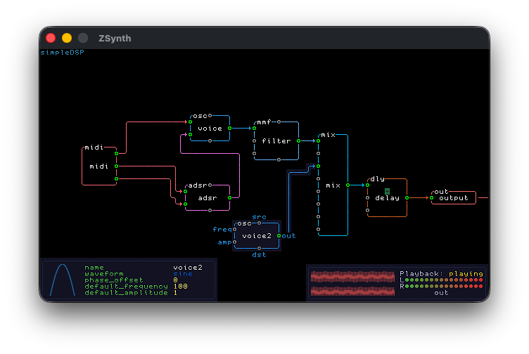

# ZSynth

    

This is a graph-based DSP: audio processing is built by connecting nodes into a
directed graph, allowing oscillators, sequencers, modulation sources, filters,
and effects to be composed into a real-time sound pipeline.

## So far

- Oscillator with sine, sawtooth, triangle and square waveforms
- Mixer: mix and pan multiple voices together
- MonophonicSequencer
- MultimodeFilter: high pass, low pass, band pass and notch
- ADSR
- BitCrusher
- Noise: white, pink and brown
- Utility nodes: Add, Multiply, Constant
- Keyboard
- MIDI input

## TODO

- color picker for nodes
- sampler
- granular (play tiny amount of samples, seems like a particle system but for
  audio)
- pitch shifter
- resampler
- cleanup command that reorganize graph to optimize paths for better readability

## Controls and UI elements

- knob
- dial
- radio/check button

The idea: you design the DSP graph and then you have can draw your UI with
prefab elements to make your own synth that looks how you want
